---
# Subscriber Usage Service

Dokumen ini berisi panduan teknis, dokumentasi arsitektur, dan instruksi operasional untuk proyek Subscriber Usage Service. Proyek ini dibangun sebagai solusi atas Technical Test yang mencakup pengembangan Backend API, otomatisasi snapshot dan retensi data, kueri analisis basis data SQL, serta penanganan masalah (troubleshooting) pada kode JavaScript.

---

## 1. Tujuan Proyek

Proyek ini bertujuan untuk menyediakan sistem backend yang andal dalam mengelola data penggunaan layanan telekomunikasi pelanggan (subscriber) dengan cakupan fungsi sebagai berikut:

1. Layanan API RESTful untuk mencatat dan menyajikan riwayat penggunaan layanan (menit telepon, jumlah SMS, dan penggunaan data internet).
2. Otomatisasi proses ekstraksi data penggunaan menjadi file laporan berkala berbasis CSV berdasarkan jadwal waktu lokal Indonesia Barat (WIB).
3. Pemeliharaan media penyimpanan secara otomatis dengan menghapus file laporan historis yang telah melewati batas retensi data tertentu.
4. Penyediaan kueri basis data relasional SQL untuk analisis statistik penggunaan pelanggan dan pengelolaan profil akun.
5. Perbaikan dan penguatan keandalan kode JavaScript pada fungsi kalkulasi agregasi data.

---

## 2. Ringkasan Tugas dan Alur Kerja

Dalam penyelesaian proyek ini, alur kerja dibagi menjadi empat komponen utama:

- Q1: Subscriber Usage API
  Mengembangkan backend service berbasis Node.js dan Express.js untuk mencatat data penggunaan pelanggan baru serta menampilkan riwayat data penggunaan baik secara keseluruhan, filter individual, maupun ringkasan agregat. Penyimpanan data utama menggunakan mekanisme in-memory storage.

- Q2: Usage Snapshot Automation and Cleanup
  Membuat sistem otomatisasi pengambilan data dari API secara berkala pada pukul 08:00, 12:00, dan 15:00 WIB menggunakan node-cron, lalu menyimpannya dalam format CSV. Selain itu, menyediakan skrip pemeliharaan terpisah untuk menghapus file snapshot CSV yang usianya melebihi 30 hari.

- Q3: Subscriber and Usage SQL
  Menyediakan kueri SQL standar untuk manipulasi data (INSERT dan UPDATE) serta kueri analisis data (SUM, ORDER BY dengan LIMIT, dan Subquery dengan HAVING) pada skema basis data relasional.

- Q4: Troubleshoot and Explain
  Menganalisis kesalahan logika pada fungsi perulangan reduce di JavaScript, melakukan perbaikan kode agar tahan terhadap data yang tidak valid, serta merumuskan strategi pencegahan bug serupa.

---
---

## 3. Struktur Berkas dan Direktori Proyek

```text
subscriber-usage-service/
├── package.json
├── .gitignore
├── .env.example
├── eslint.config.js
├── crontab.example
├── README.md
├── src/
├── scripts/
├── sql/
├── q4/
├── tests/
├── public/
├── snapshots/
└── logs/

```

### Penjelasan Detail Fungsi Berkas & Direktori

Berikut adalah rincian fungsi dari masing-masing komponen di dalam proyek:

#### A. Berkas Konfigurasi Utama (Root)

* **`package.json`**: Berisi konfigurasi proyek Node.js, daftar dependensi pustaka, serta definisi skrip otomatisasi (`npm scripts`).
* **`.gitignore`**: Daftar berkas dan direktori yang dikecualikan agar tidak ikut terunggah ke repositori Git (seperti `node_modules`, `.env`, dll).
* **`.env.example`**: Berkas templat untuk variabel lingkungan (*environment variables*).
* **`eslint.config.js`**: Aturan pemindaian dan pemeriksaan kualitas kode statis (*linter*).
* **`crontab.example`**: Referensi konfigurasi penjadwalan *cron job* untuk sistem operasi Linux.
* **`README.md`**: Dokumentasi utama panduan operasional proyek.

#### B. Direktori Sumber Kode (`src/`)

* **`server-db.js`**: Titik masuk (*entry point*) utama peladen Express.js yang terhubung langsung ke basis data relasional PostgreSQL.
* **`app.js`**: Definisi aplikasi Express.js, pendaftaran rute API, dan middleware penanganan kesalahan (*error handling*).
* **`service.js`**: Logika bisnis utama untuk pencatatan, pemfilteran, dan agregasi data.
* **`validation.js`**: Modul validasi ketat untuk tipe data dan format payload permintaan (*request*).
* **`server.js`**: *(Legacy)* Titik masuk alternatif untuk mode penyimpanan memori sementara (*in-memory*).
* **`store.js`**: *(Legacy)* Modul penyimpanan data berbasis memori sementara.
* **`seed.js`**: *(Legacy)* Data awal sampel untuk mode memori.
* **`src/lib/csv.js`**: Utilitas untuk mengonversi objek JSON ke format CSV beserta prosedur *escaping*.
* **`src/lib/time.js`**: Utilitas manipulasi waktu dan format penamaan berkas berbasis zona waktu WIB.

#### C. Direktori Skrip Otomatisasi (`scripts/`)

* **`snapshot.js`**: Skrip mandiri untuk mengambil data dari API dan menyimpannya ke berkas CSV secara atomik.
* **`scheduler.js`**: Proses latar belakang penjadwal otomatis berbasis *cron* untuk eksekusi snapshot dan pembersihan berkas.
* **`cleanup.js`**: Skrip pemindai dan pembersih berkas CSV snapshot lama yang melebihi batas retensi (> 30 hari).

#### D. Direktori Basis Data & SQL (`sql/`)

* **`schema.sql`**: Berisi skema pembuatan tabel relasional basis data beserta data sampel awalnya.
* **`queries.sql`**: Kumpulan kueri SQL lengkap untuk menjawab instruksi pengujian pada bagian Q3.

#### E. Direktori Troubleshooting & Pengujian (`q4/` & `tests/`)

* **`q4/getTotalUsageMB.js`**: Implementasi fungsi awal yang mengalami galat (*buggy*) beserta perbaikannya untuk tugas Q4.
* **`tests/service.test.js`**: Pengujian otomatis untuk rute API dan logika bisnis.
* **`tests/automation.test.js`**: Pengujian otomatis untuk skrip snapshot, penjadwal, dan pembersihan berkas.
* **`tests/lib.test.js`**: Pengujian unit untuk fungsi utilitas CSV dan format waktu WIB.
* **`tests/q4.test.js`**: Pengujian unit untuk memvalidasi perbaikan fungsi pada Q4.

#### F. Direktori Antarmuka, Output, & Log (`public/`, `snapshots/`, `logs/`)

* **`public/index.html`**: Antarmuka web *frontend* sederhana untuk berinteraksi langsung dengan API.
* **`snapshots/`**: Direktori tempat penyimpanan hasil keluaran berkas laporan berformat CSV.
* **`logs/`**: Direktori tempat penyimpanan catatan log eksekusi sistem.

## 4. Rincian Pengujian (Testing)

Proyek ini dilengkapi dengan 20 skenario pengujian otomatis yang dijalankan menggunakan test runner bawaan Node.js (node --test) tanpa memerlukan modul pengujian pihak ketiga.

Cakupan pengujian meliputi:

1. Pengujian Logika API dan Service (src/service.js, src/validation.js)
   - Validasi payload request POST /api/usage (memastikan penolakan terhadap tipe data salah, angka negatif, dan string kosong).
   - Pengujian pemfilteran data penggunaan berdasarkan ID pelanggan dan rentang tanggal ISO-8601 pada GET /api/usage.
   - Pengujian kalkulasi rata-rata dan akumulasi total penggunaan pada endpoint GET /api/usage/summary.

2. Pengujian Utilitas dan Format Data (src/lib/csv.js, src/lib/time.js)
   - Escaping karakter khusus pada CSV (tanda petik, koma, baris baru) serta penanganan formula injection guard.
   - Pembentukan nama file berbasis zona waktu Asia/Jakarta (WIB) dan fungsi parser nama file kembali ke objek Date.

3. Pengujian Otomatisasi dan Pemeliharaan (scripts/snapshot.js, scripts/cleanup.js)
   - Penulisan file CSV secara atomik (penulisan ke berkas sementara .tmp sebelum diubah namanya).
   - Penanganan kegagalan koneksi API agar tidak meninggalkan berkas sampah.
   - Perhitungan retensi file pada skrip cleanup (memastikan file tepat berusia di atas 30 hari terhapus dan file non-snapshot tidak tersentuh).
   - Verifikasi mode simulasi (--dry-run).

4. Pengujian Kode Troubleshooting (q4/getTotalUsageMB.js)
   - Verifikasi kegagalan pada fungsi lama saat menerima array multi-elemen, single-element, dan array kosong.
   - Verifikasi keberhasilan fungsi baru dalam mengkalkulasi total dataUsageMB, menangani string angka, serta melemparkan TypeError yang sesuai pada data tidak valid.

---

## 5. Panduan Menjalankan dan Daftar Perintah (Commands)

### Prasyarat System
- Node.js versi 18.0.0 atau lebih baru (disarankan versi LTS 20/22).
- npm (Node Package Manager).
- Git.
- Docker.

### 1. Instalasi Dependensi
Jalankan perintah berikut pada terminal di direktori utama proyek:

npm install

### 2. Menjalankan Pengujian Otomatis
Untuk memastikan seluruh 20 skenario pengujian berjalan dengan sukses:

npm test

### 3. Menjalankan Aplikasi Backend API
Untuk menjalankan API server pada mode standar (port default 3000):

npm start

Jika menggunakan konfigurasi dari file variabel lingkungan (.env):

npm run start:env

### 4. Menguji API Menggunakan Command Line (Terminal Lain)
- Mencatat data penggunaan baru:
  curl -X POST http://localhost:3000/api/usage -H "Content-Type: application/json" -d '{"subscriberId":"SUB01","callMinutes":40,"smsCount":10,"dataUsageMB":1500}'

- Mengambil riwayat penggunaan pelanggan tertentu:
  curl "http://localhost:3000/api/usage?subscriberId=SUB02"

- Mengambil ringkasan statistik penggunaan:
  curl http://localhost:3000/api/usage/summary

- Memeriksa status kesehatan server:
  curl http://localhost:3000/health

### 5. Menjalankan Otomatisasi Snapshot dan Cleanup
- Mengambil satu snapshot data secara manual saat ini:
  npm run snapshot

- Menjalankan penjadwal otomatis berbasis background process (08:00, 12:00, 15:00 WIB & Cleanup 00:30 WIB):
  npm run scheduler

- Menjalankan penjadwal dengan konfigurasi variabel lingkungan:
  npm run scheduler:env

- Menjalankan simulasi pembersihan file snapshot lama tanpa menghapus (Dry Run):
  npm run cleanup:dry

- Menjalankan pembersihan file snapshot lama (> 30 hari) secara permanen:
  npm run cleanup

### 6. Menjalankan Pemeriksaan Kualitas Kode (Linter)
npm run lint

---

# Dokumentasi Teknis Lengkap: Q1 - Subscriber Usage API

## 1. Spesifikasi dan Tujuan Tugas

Bagian pertama dari pengujian ini mengharuskan pembangunan sebuah layanan *backend* yang memungkinkan pencatatan (*record*) serta pengambilan kembali (*retrieve*) data penggunaan layanan telekomunikasi pelanggan (*subscriber*). Setiap catatan penggunaan (*usage record*) mencakup empat parameter utama:

* `subscriberId`: Identifikasi unik pelanggan.
* `callMinutes`: Durasi panggilan dalam satuan menit.
* `smsCount`: Jumlah pengiriman pesan singkat (SMS).
* `dataUsageMB`: Konsumsi data internet dalam satuan Megabyte (MB).

Implementasi ini dibangun menggunakan **Node.js** dan kerangka kerja **Express.js**, dengan sistem penyimpanan data sementara di memori aplikasi (*in-memory storage*).

---

## 2. Desain Endpoint dan Metode HTTP

Berikut adalah pemetaan rute API, metode HTTP, fungsi, serta kode status respons yang didukung oleh sistem:

| Metode HTTP | Endpoint Path | Fungsi Utama | Kode Status Sukses |
| --- | --- | --- | --- |
| **POST** | `/api/usage` | Merekam data penggunaan baru untuk seorang pelanggan | `201 Created` |
| **GET** | `/api/usage` | Mengambil daftar seluruh riwayat penggunaan dengan opsi filter | `200 OK` |
| **GET** | `/api/usage/:id` | Mengambil detail satu catatan penggunaan spesifik berdasarkan ID | `200 OK` / `404 Not Found` |
| **GET** | `/api/usage/summary` | Menampilkan ringkasan total dan rata-rata penggunaan per pelanggan | `200 OK` |
| **GET** | `/health` | Memeriksa status kesehatan dan ketersediaan server | `200 OK` |

---

## 3. Penjelasan Kode Sumber (Source Code Explanation) per Berkas

Untuk menjaga struktur kode tetap rapi, mudah dipelihara, dan mudah diuji (*testable*), logika aplikasi dipecah ke dalam beberapa modul terpisah:

### A. Titik Masuk Utama (`src/server.js`)

Berkas ini bertugas sebagai titik inisialisasi utama aplikasi.

* Mengimpor fungsi pembuatan aplikasi dari `app.js` dan kelas penyimpanan dari `store.js`.
* Melakukan pengisian data awal (*seeding*) menggunakan data sampel dari `seed.js` kecuali variabel lingkungan `SEED=false` diaktifkan.
* Menjalankan server HTTP Express pada nomor port tertentu (default: `3000`).

### B. Lapisan Perutean HTTP (`src/app.js`)

Berkas ini mendefinisikan aplikasi Express dan menangani pemetaan rute API.

* Menggunakan middleware bawaan `express.json({ limit: '100kb' })` untuk memproses *request body* berformat JSON.
* Mendaftarkan rute `/api/usage/summary` **sebelum** rute dinamis `/api/usage/:id` untuk mencegah Express salah membaca kata "summary" sebagai parameter ID.
* Menyediakan *error handler* global untuk menangkap korupsi format JSON (mengembalikan HTTP `400 InvalidJSON`) dan rute yang tidak dikenal (mengembalikan HTTP `404 NotFound`).

### C. Logika Bisnis Murni (`src/service.js`)

Berkas ini berisi seluruh aturan bisnis tanpa terikat langsung dengan kerangka kerja HTTP, sehingga sangat mudah diuji secara independen.

* `create(body)`: Memanggil modul validasi. Jika validasi gagal, mengembalikan status `400` beserta daftar kesalahan. Jika berhasil, memanggil `store.add(value)` dan mengembalikan status `201`.
* `list(query)`: Mendukung pemfilteran berdasarkan `subscriberId` serta rentang waktu `from` dan `to` yang divalidasi ke format ISO-8601.
* `get(rawId)`: Mengambil satu catatan spesifik berdasarkan ID numerik. Jika tidak ditemukan, mengembalikan status `404`.
* `summary(query)`: Melakukan agregasi data dengan mengelompokkan catatan per pelanggan, menghitung total snapshot, total menit panggilan, total SMS, total data, serta merata-rata durasi panggilan (`avgCallMinutes`).

### D. Modul Validasi Input (`src/validation.js`)

Memastikan integritas data yang masuk dari klien dengan aturan ketat:

* Memastikan `subscriberId` berupa string yang tidak kosong setelah dipangkas spasi (`trim()`).
* Memastikan tiga metrik (`callMinutes`, `smsCount`, `dataUsageMB`) berupa angka yang valid dan bernilai lebih besar atau sama dengan nol (`>= 0`).
* Memastikan `smsCount` berupa bilangan bulat (*integer*).
* Menambahkan penanda waktu `timestamp` otomatis dalam format ISO-8601 jika tidak disediakan oleh klien.

### E. Penyimpanan Memori Sementara (`src/store.js`)

Mengimplementasikan kelas `UsageStore` untuk mengelola penyimpanan data di dalam memori RAM:

* Menyimpan data dalam bentuk *array* `records` dan menggunakan penghitung otomatis `nextId` yang bertambah secara inkremental setiap kali data baru ditambahkan.
* Menyediakan fungsi pencarian `getById(id)` dan penyaringan `list({ subscriberId, from, to })`.

---

## 4. Rincian Bentuk Request dan Response API

### A. Mencatat Penggunaan Baru

* **Endpoint:** `POST /api/usage`
* **Content-Type:** `application/json`
* **Request Body (Contoh):**
```json
{
  "subscriberId": "SUB01",
  "callMinutes": 45,
  "smsCount": 12,
  "dataUsageMB": 1800
}

```


* **Response Sukses (HTTP 201 Created):**
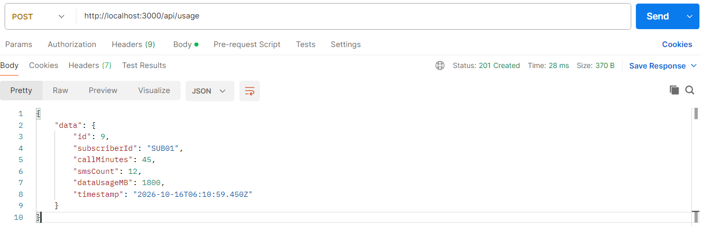


* **Response Gagal Validasi (HTTP 400 Bad Request):**
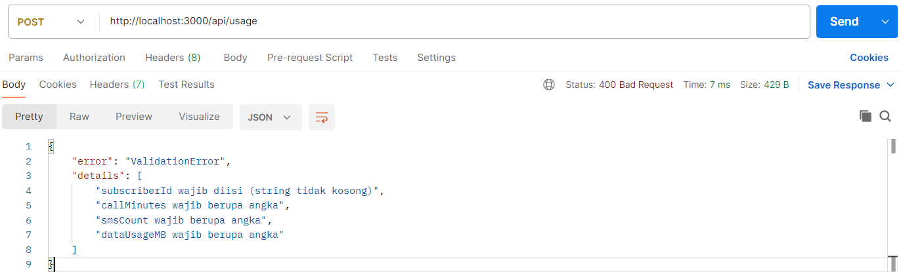


### B. Mengambil Daftar Riwayat Penggunaan

* **Endpoint:** `GET /api/usage`
* **Parameter Query Opsional:** `subscriberId`, `from`, `to`
* **Response Sukses (HTTP 200 OK):**
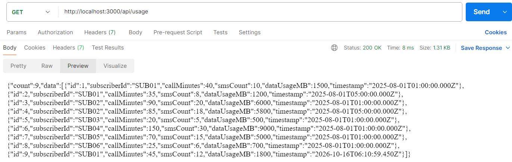


### C. Mengambil Detail Satu Catatan Berdasarkan ID

* **Endpoint:** `GET /api/usage/:id` (Contoh: `/api/usage/1`)
* **Response Sukses (HTTP 200 OK):**
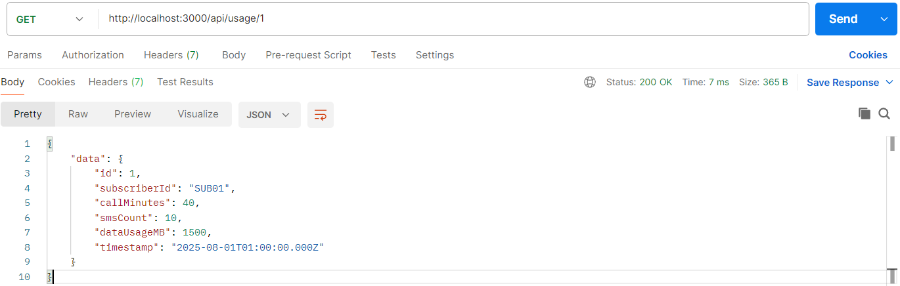


### D. Mengambil Ringkasan Penggunaan (Summary)

* **Endpoint:** `GET /api/usage/summary`
* **Response Sukses (HTTP 200 OK):**
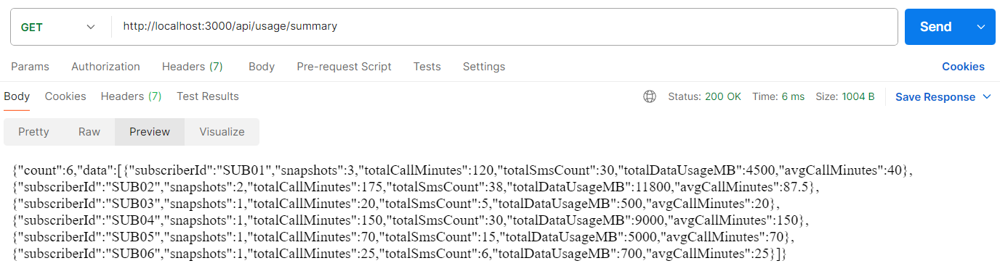


---

## 5. Panduan Pengujian Menggunakan Postman

Untuk menguji seluruh fungsionalitas API Q1 menggunakan aplikasi **Postman**, ikuti langkah-langkah praktis berikut:

1. **Nyalakan Server API:**
Buka terminal pada direktori proyek, lalu jalankan perintah:
```bash
npm start

```


Pastikan muncul log informasi bahwa server berjalan di `http://localhost:3000`.
2. **Uji Endpoint Health Check (GET):**
* Buka aplikasi Postman, buat *Request* baru dengan metode **GET**.
* Masukkan URL: `http://localhost:3000/health`
* Klik **Send**. Pastikan respons mengembalikan status `200 OK` dengan informasi status `ok`.
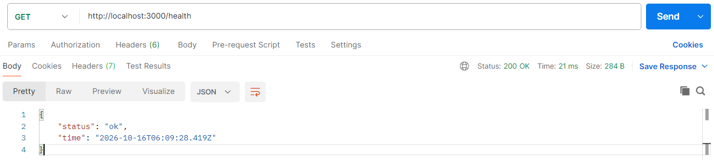


3. **Uji Endpoint Mencatat Penggunaan Baru (POST):**
* Buat *Request* baru dengan metode **POST**.
* Masukkan URL: `http://localhost:3000/api/usage`
* Pada tab **Headers**, tambahkan key `Content-Type` dengan nilai `application/json`.
* Pada tab **Body**, pilih opsi **raw** dan format **JSON**, lalu masukkan *payload* berikut:
```json
{
  "subscriberId": "SUB07",
  "callMinutes": 50,
  "smsCount": 15,
  "dataUsageMB": 2000
}

```


* Klik **Send**. Pastikan respons mengembalikan status `201 Created` beserta objek data yang baru saja direkam lengkap dengan atribut `id` dan `timestamp`.
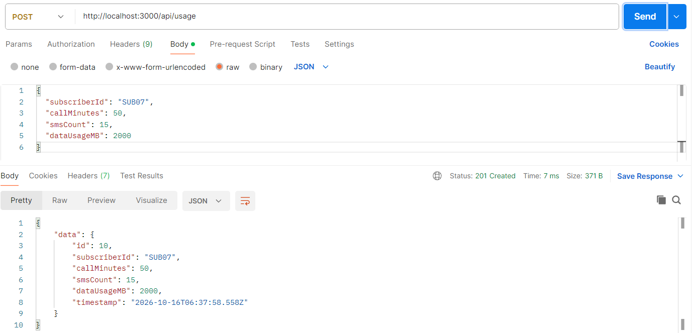


4. **Uji Endpoint Mengambil Daftar dan Filter (GET):**
* Buat *Request* baru dengan metode **GET**.
* Masukkan URL: `http://localhost:3000/api/usage?subscriberId=SUB01`
* Klik **Send**. Pastikan server mengembalikan daftar catatan yang hanya dimiliki oleh pelanggan `SUB01`.
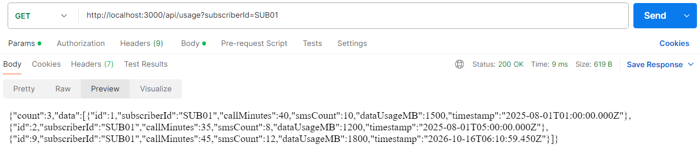


5. **Uji Endpoint Ringkasan (GET Summary):**
* Buat *Request* baru dengan metode **GET**.
* Masukkan URL: `http://localhost:3000/api/usage/summary`
* Klik **Send**. Pastikan server menampilkan rekapitulasi total akumulasi dan rata-rata metrik untuk seluruh pelanggan.
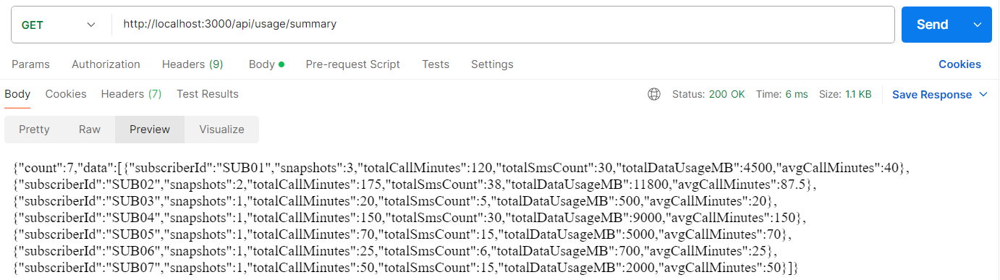

## 6. Simple Frontend

Pada bagian ini anda dapat mengakses `http://localhost:3000` pada halaman browser, untuk melakukan pengetesan dalam penggunaan halaman Simple Frontend.
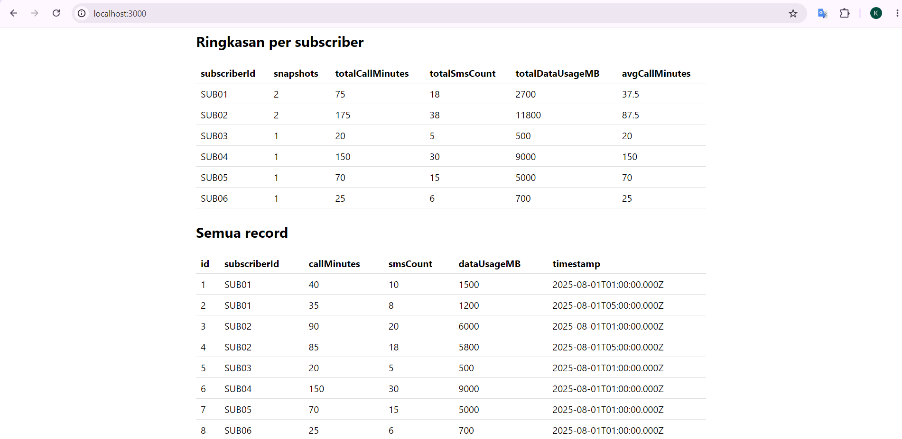


# Dokumentasi Teknis Lengkap: Q2 - Usage Snapshot Automation and Cleanup

## 1. Spesifikasi dan Tujuan Tugas

Bagian kedua dari pengujian ini berfokus pada aspek otomatisasi operasional backend (DevOps dasar). Tugas ini mengharuskan pembuatan sistem penjadwal otomatis (*cron job*) yang berjalan sebanyak 3 kali sehari pada waktu spesifik Indonesia Barat (WIB), yaitu pukul **08:00, 12:00, dan 15:00 WIB**. Sistem ini bertugas mengambil seluruh data penggunaan pelanggan dari API yang sedang berjalan, lalu menyimpannya secara otomatis ke dalam format file laporan CSV.

Selain itu, tugas ini mencakup pembuatan skrip pemeliharaan terpisah (*cleanup script*) untuk memindai dan menghapus file laporan snapshot lama yang usianya telah melebihi batas kebijakan retensi (di atas 30 hari).

---

## 2. Rancang Bangun dan Keputusan Desain

1. **Penggunaan Zona Waktu Eksplisit (`Asia/Jakarta`)**
Penjadwal menggunakan pustaka `node-cron` dengan konfigurasi zona waktu dipatok ke `Asia/Jakarta` (WIB, UTC+7 tanpa penyesuaian waktu musim / *DST*). Pendekatan ini memastikan jadwal eksekusi tetap konsisten sepanjang tahun tanpa bergeser meskipun server fisik atau kontainer cloud di-deploy pada zona waktu UTC.
2. **Pengambilan Sumber Data via HTTP (`GET /api/usage`)**
Karena penyimpanan utama berada di memori aplikasi (`in-memory storage`) yang hidup di dalam proses server API, skrip snapshot tidak membaca memori secara langsung melainkan melakukan permintaan HTTP keluar (`fetch`) ke endpoint API internal (`/api/usage`). Desain ini mensimulasikan arsitektur layanan mikro terdistribusi yang bersih.
3. **Konvensi Penamaan Berbasis Waktu WIB**
File laporan CSV dihasilkan menggunakan pola penamaan baku: `usage_snapshot_YYYY-MM-DD_HHmm.csv` (contoh: `usage_snapshot_2026-10-16_0800.csv`). Format ini memiliki keunggulan di mana urutan alfabetis pada sistem berkas sama persis dengan urutan kronologis waktu, sehingga mempermudah pengurutan dan pencarian data historis.
4. **Metode Penulisan Berkas Atomik (Atomic File Writing)**
Untuk mencegah risiko file laporan korup atau setengah jadi akibat proses terputus di tengah penulisan, sistem menerapkan teknik penulisan atomik: data CSV pertama kali ditulis ke dalam berkas sementara berformat `.tmp` (contoh: `usage_snapshot_..._0800.csv.tmp`), setelah proses penulisan selesai sepenuhnya, berkas tersebut diubah namanya (`fs.rename`) secara instan menjadi nama aslinya.
5. **Kebijakan Retensi Berbasis Nama Berkas (Filename-Based Retention)**
Skrip pemeliharaan (*cleanup*) menghitung umur file berdasarkan stempel waktu yang tertulis langsung pada nama file snapshot (bukan menggunakan waktu modifikasi sistem berkas / `mtime`). Hal ini menjamin akurasi umur data tetap valid meskipun berkas dipindahkan, disalin antar server, atau direstore dari media cadangan.

---

## 3. Penjelasan Kode Sumber (Source Code Explanation) per Berkas

### A. Modul Utilitas Waktu dan Zona Waktu (`src/lib/time.js`)

Berkas ini bertanggung jawab penuh atas manipulasi zona waktu dan format penamaan:

* `wibParts(date)`: Memformat objek waktu JavaScript ke dalam komponen tahun, bulan, hari, jam, dan menit spesifik zona waktu `Asia/Jakarta` menggunakan API `Intl.DateTimeFormat`.
* `snapshotFileName(date)`: Menghasilkan string nama file berformat `usage_snapshot_YYYY-MM-DD_HHmm.csv` berdasarkan waktu WIB saat ini.
* `parseSnapshotFileName(name)`: Melakukan *parsing* balik dari string nama file snapshot menjadi objek tanggal `Date` untuk keperluan validasi umur file pada skrip cleanup.

### B. Modul Utilitas Konversi CSV (`src/lib/csv.js`)

Berkas ini menangani konversi data array objek ke format teks berstandar CSV:

* `escapeCell(value)`: Menerapkan standar RFC 4180 untuk menangani sel yang mengandung tanda petik, koma, atau baris baru, serta menyertakan pengaman tambahan (*formula injection guard*) dengan menyisipkan tanda kutip tunggal pada karakter awal pencetus formula (`=`, `+`, `-`, `@`).
* `toCsv(rows, columns)`: Menyusun baris header dan data objek menjadi format teks CSV yang rapi.

### C. Skrip Pengambilan Snapshot (`scripts/snapshot.js`)

Berkas ini dapat dieksekusi secara mandiri maupun dipanggil oleh penjadwal:

* Melakukan panggilan HTTP (`fetch`) ke endpoint `${apiUrl}/api/usage` dengan batas waktu tunggu (*timeout*) 10 detik.
* Membaca data array yang dikembalikan API, memastikan direktori penyimpanan `snapshots/` tersedia, lalu menulisnya ke file `.tmp` dan melakukan *rename* atomik ke file tujuan akhir.

### D. Skrip Penjadwal Otomatis (`scripts/scheduler.js`)

Proses latar belakang jangka panjang (*long-running process*):

* Menggunakan `cron.schedule` untuk menjadwalkan eksekusi snapshot pada ekspresi `0 8,12,15 * * *` (pukul 08:00, 12:00, dan 15:00 WIB).
* Menjadwalkan tugas pembersihan harian (*cleanup*) pada ekspresi `30 0 * * *` (pukul 00:30 WIB) setiap harinya.
* Menyertakan parameter `{ timezone: 'Asia/Jakarta' }` untuk memastikan akurasi waktu eksekusi.

### E. Skrip Pemeliharaan dan Pembersihan (`scripts/cleanup.js`)

Berkas pemindai folder laporan:

* Membaca seluruh isi direktori penyimpanan snapshot.
* Memeriksa nama file satu per satu menggunakan fungsi `parseSnapshotFileName`. Jika bukan file snapshot, file tersebut diabaikan dan tidak disentuh.
* Membandingkan umur file terhadap batas ambang retensi (default 30 hari yang dikonversi ke milidetik).
* Mendukung argumen `--dry-run` untuk melakukan simulasi penghapusan tanpa benar-benar menghapus file, serta parameter `--days=N` untuk mengubah ambang batas hari retensi secara fleksibel.

---

## 4. Panduan Pengujian Otomatisasi Menggunakan Postman dan Terminal

Untuk menguji fungsionalitas otomatisasi snapshot dan cleanup secara langsung, ikuti langkah-langkah praktis berikut:

### Langkah 1: Pastikan Server API Menyala

Buka Terminal 1, pastikan server backend API sedang aktif berjalan:

```bash
npm start

```

*(Server berjalan di `http://localhost:3000` dengan data awal atau data hasil pencatatan Q1).*

### Langkah 2: Menguji Pengambilan Snapshot Manual via Terminal

Buka Terminal 2 (di direktori proyek yang sama) untuk memicu pembuatan snapshot secara instan tanpa harus menunggu jam jadwal cron:

```bash
npm run snapshot

```

**Hasil yang diharapkan di Terminal:**

Periksa direktori `snapshots/` pada proyek Anda, pastikan file berformat CSV dengan stempel waktu WIB berhasil tercipta dengan rapi.
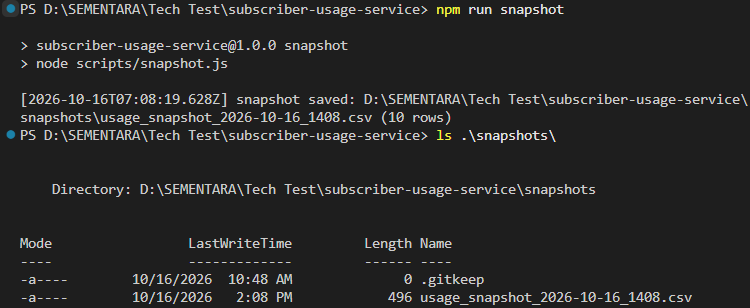

### Langkah 3: Menguji Mode Simulasi Cleanup (`dry-run`)

Untuk menguji skrip pemeliharaan tanpa risiko kehilangan data penting, jalankan perintah simulasi:

```bash
npm run cleanup:dry

```

**Hasil yang diharapkan:** Skrip akan memindai folder dan melaporkan file mana saja yang memenuhi kriteria umur di atas 30 hari (jika ada) tanpa menghapusnya dari direktori.
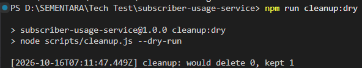

Berdasarkan hasil eksekusi pada gambar, skrip simulasi pembersihan (dry-run) berhasil memindai folder dan mendeteksi 1 file snapshot yang masih berada di dalam batas waktu retensi (di bawah 30 hari), sehingga file tersebut dipertahankan (kept 1) dan tidak ada file yang dihapus (would delete 0).

Apabila Anda mengetikkan parameter tambahan ke dalam perintah spesifik seperti (--days=N):

```bash
npm run cleanup:dry -- --days=0

```

Tanda pemisah `--` (double dash) digunakan untuk meneruskan argumen dari npm script ke dalam skrip Node.js yang mendasarinya (`scripts/cleanup.js`). Argumen `--days=0` berfungsi untuk **mengubah ambang batas masa retensi file secara instan** menjadi 0 hari.

Ketika perintah tersebut dijalankan, sistem akan memberikan hasil log sebagai berikut:
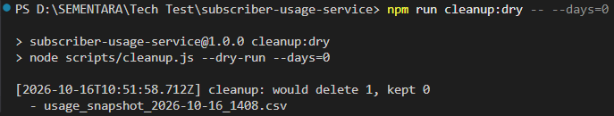

### Langkah 4: Menjalankan Pembersihan Nyata (`cleanup`)

Jika Anda ingin mengeksekusi penghapusan file snapshot yang usianya telah melewati batas 30 hari secara permanen, jalankan:

```bash
npm run cleanup

```
Ketika dijalankan secara standar tanpa parameter tambahan, skrip akan menggunakan batas default (30 hari). Jika file snapshot masih baru (berusia di bawah 30 hari), sistem tidak akan menghapus apa pun:
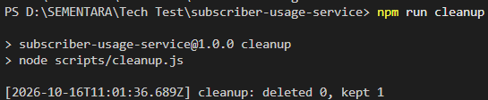

Namun sama seperti mode simulasi sebelumnya, Anda dapat menggunakan parameter tambahan `-- --days=0` untuk menguji penghapusan secara nyata tanpa harus menunggu 30 hari:

```bash
npm run cleanup -- --days=0

```

Hasil eksekusi terminal dan pemeriksaan direktori:
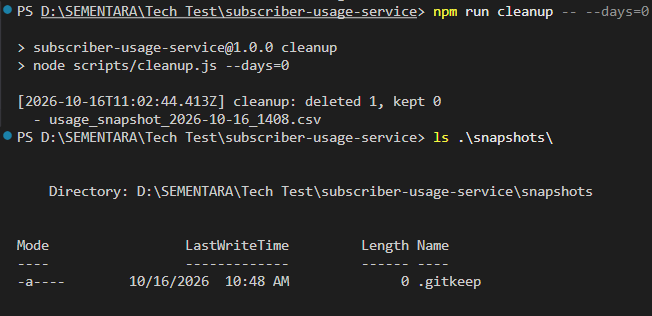

Perintah di atas memaksa ambang batas retensi menjadi 0 hari, sehingga file snapshot yang ada langsung dihapus secara permanen dari direktori fisik (`deleted 1`). Ketika direktori `snapshots/` diperiksa menggunakan perintah `ls`, file CSV laporan telah hilang dan hanya menyisakan berkas penjaga `.gitkeep`.

### Langkah 5: Menjalankan Penjadwal Latar Belakang (`scheduler`)

Untuk menguji proses otomatisasi penuh yang berjalan terus-menerus sesuai jadwal jam 08:00, 12:00, dan 15:00 WIB (eksekusi proses snapshot) dan jam 00:30 WIB (eksekusi proses cleanup) :

```bash
npm run scheduler

```

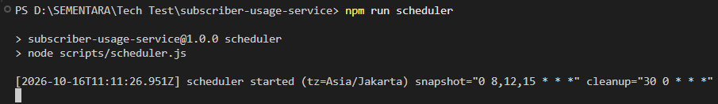

Biarkan proses berjalan di terminal. Penjadwal akan otomatis mencetak log di konsol setiap kali waktu eksekusi snapshot atau pembersihan harian tercapai. Tekan `Ctrl + C` untuk menghentikan penjadwal jika pengujian telah selesai.

Namun, untuk menguji proses otomatisasi penjadwal secara instan tanpa harus menunggu jam operasional asli (08:00, 12:00, 15:00, atau 00:30 WIB), Anda dapat mengubah ekspresi *cron* sementara pada berkas **`scripts/scheduler.js`**:

1. Buka berkas `scripts/scheduler.js`, lalu ubah variabel penjadwal menjadi:
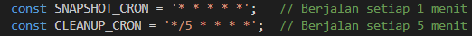

2. Jalankan perintah penjadwal di terminal:
```bash
npm run scheduler

```
3. Biarkan proses berjalan selama 1 hingga 2 menit. Anda akan melihat log terminal mencetak eksekusi snapshot secara otomatis setiap menitnya:
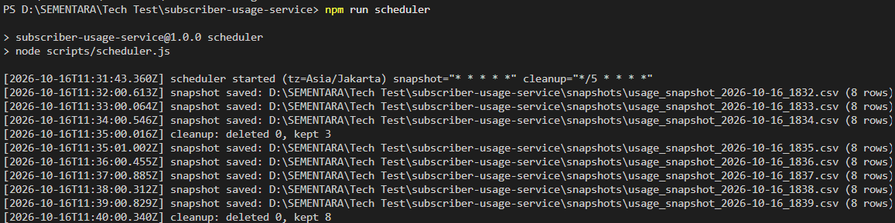

4. Tekan `Ctrl + C` untuk menghentikan penjadwal jika pengujian telah selesai, lalu kembalikan ekspresi cron ke pengaturan aslinya (`0 8,12,15 * * *` dan `30 0 * * *`) sebelum melakukan *commit* ke Git.

# Dokumentasi Teknis Lengkap: Q3 - Relational Database Integration & SQL Implementation

---

## 1. Spesifikasi dan Tujuan Tugas

Bagian ketiga dari rangkaian pengujian ini berfokus pada perancangan basis data relasional (*Relational Database Management System* / RDBMS), penulisan kueri SQL tingkat lanjut untuk analisis data, serta integrasi sisi peladen (*backend*) agar dapat beralih dari penyimpanan memori sementara (*in-memory storage*) ke penyimpanan persisten menggunakan **PostgreSQL**.

Tugas ini menguji kemampuan dalam:

1. Merancang skema tabel relasional (`subscribers` dan `subscriber_usage`) dengan konvensi penamaan standar industri (*snake_case*) dan kendala integritas data (*primary key*, *foreign key*, serta *check constraint*).
2. Mengeksekusi operasi manipulasi data (penyisipan dan pembaruan data berdasarkan *Primary Key*).
3. Melakukan agregasi data kompleks, pengurutan deterministik dengan *tie-breaker*, serta implementasi *subquery* berkinerja tinggi.
4. Menghubungkan aplikasi Express.js ke kontainer basis data eksternal menggunakan driver klien resmi (`pg`).

---

## 2. Rancang Bangun dan Keputusan Desain

1. **Pemisahan Berkas Peladen Database (`src/server-db.js`)**
Alih-alih merusak atau mengubah logika penyimpanan *in-memory* yang sudah teruji pada skrip utama (`src/server.js`), dibuat file peladen mandiri khusus mode basis data (`src/server-db.js`). Pendekatan ini menjaga modularitas kode tetap bersih dan memastikan pengujian otomatis bawaan (`npm test`) tetap berjalan tanpa memerlukan koneksi database eksternal.
2. **Penyesuaian Skema Tabel (`subscriber_usage`)**
Nama tabel dinamai `subscriber_usage` (bukan sekadar `usage`) untuk menghindari konflik dengan kata kunci cadangan (*reserved keywords*) di beberapa RDBMS populer seperti MySQL. Seluruh kolom dirancang menggunakan format `snake_case` (`subscriber_id`, `call_minutes`, `sms_count`, `data_usage_mb`, `recorded_at`) agar selaras dengan standar SQL global.
3. **Pembersihan String Lingkungan (*Sanitization*)**
Untuk mencegah kegagalan autentikasi akibat karakter tersembunyi, spasi tak terlihat, atau *Carriage Return* (`\r`) pada berkas `.env` Windows, ditambahkan fungsi utilitas pembersih string (`sanitize`) pada parameter koneksi pangkalan data.
4. **Pemindahan Port Operasional ke Port 4000**
Mode basis data dijalankan pada port `4000` (menggantikan port default `3000`). Hal ini dilakukan secara sengaja untuk menghindari galat pembatasan hak akses sistem operasi Windows (*Permission Denied / EACCES*) atau bentrok dengan proses latar belakang peladen lain yang mungkin masih mengunci port 3000.

---

## 3. Penjelasan Perubahan dan Penambahan Berkas (*Code Changes & Additions*)

Berikut adalah rincian perubahan dan penambahan berkas yang dilakukan pada proyek:

### A. Penambahan Dependensi dan Skrip pada `package.json`

* **Penambahan Klien Database (`dependencies`)**: Menambahkan pustaka **`pg`** (`^8.11.3`) sebagai jembatan komunikasi antara aplikasi Node.js dan peladen PostgreSQL.


* **Penambahan Skrip Eksekusi (`scripts`)**: Menambahkan skrip pintasan `"prod"` dan `"db"` untuk menjalankan peladen berbasis basis data dengan perintah `node --env-file=.env src/server-db.js`.


### B. Pembaruan Konfigurasi Lingkungan pada `.env`

Berkas `.env` disesuaikan untuk menampung parameter koneksi basis data relasional serta mengalihkan port peladen:

* `PORT=4000` (Menghindari bentrok port 3000).


* `SEED=false` (Mematikan pengisian data in-memory otomatis karena data sudah dikelola langsung oleh tabel PostgreSQL).


* Parameter koneksi: `DB_HOST=127.0.0.1`, `DB_PORT=5432`, `DB_USER=postgres`, `DB_PASSWORD=secret`, `DB_NAME=subscriber_db`.


### C. Pembuatan Peladen Basis Data (`src/server-db.js`)

Berkas ini bertindak sebagai pintu gerbang penghubung antara kerangka kerja Express.js dan kontainer PostgreSQL:

* **Koneksi Kumpulan Klien (`Pool`)**: Menginisialisasi objek `Pool` dari modul `pg` menggunakan parameter konfigurasi yang telah dibersihkan oleh fungsi `sanitize`.


* **Rute API Asinkron**: Menyediakan endpoint `/api/usage` (GET & POST) dan `/api/usage/summary` yang langsung mengeksekusi kueri SQL asli (`INSERT`, `SELECT`, `GROUP BY`, `COUNT`, `SUM`, `AVG`) ke dalam database relasional.


* **Kesesuaian Kontrak API**: Melakukan pemetaan (*mapping*) balik dari kolom *snake_case* database ke format properti *camelCase* (`subscriberId`, `callMinutes`, dll.) agar antarmuka web statis (`public/index.html`) dapat merender data secara identik tanpa galat.


---

## 4. Panduan Penyiapan Basis Data (Docker & PostgreSQL)

Untuk menyiapkan lingkungan basis data relasional secara cepat dan terisolasi, jalankan perintah-perintah berikut secara berurutan di terminal bash Anda:

### Langkah 1: Menjalankan Kontainer Docker PostgreSQL

```bash
docker run --name subscriber-db -e POSTGRES_USER=postgres -e POSTGRES_PASSWORD=secret -e POSTGRES_DB=subscriber_db -p 5432:5432 -d postgres:15-alpine

```

### Langkah 2: Menyalin Berkas Skema ke Dalam Kontainer

```bash
docker cp sql/schema.sql subscriber-db:/schema.sql

```

### Langkah 3: Mengeksekusi Skema dan Pengisian Data Awal (*Seed*)

```bash
docker exec -it subscriber-db psql -U postgres -d subscriber_db -f /schema.sql

```
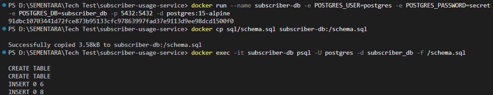

*Hasil eksekusi terminal akan menampilkan konfirmasi pembuatan tabel dan penyisipan data awal (`CREATE TABLE`, `INSERT 0 6`, `INSERT 0 8`).*

---

## 5. Panduan Menjalankan Layanan Mode Database (`npm run prod`)

Setelah basis data siap dan kontainer berjalan aktif, jalankan aplikasi backend pada port alternatif (`4000`) untuk menghindari konflik port sistem:

```bash
npm run prod

```
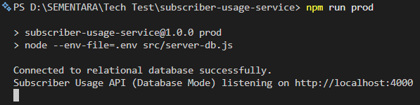

**Output Terminal yang Diharapkan:**

*Aplikasi kini tersambung ke PostgreSQL dan dapat diakses melalui peramban pada alamat `http://localhost:4000`.*

---

## 6. Panduan Pengujian Kueri SQL Manual via CLI (`psql`) dan Hasil Data Soal

Untuk masuk ke antarmuka baris perintah (*CLI*) basis data PostgreSQL di dalam kontainer Docker secara interaktif, gunakan perintah lengkap berikut:

```bash
docker exec -it subscriber-db psql -U postgres -d subscriber_db

```

Setelah masuk ke dalam prompt interaktif `subscriber_db=#`, Anda dapat menguji rangkaian kueri penyelesaian tugas Q3 beserta hasil ekspektasinya:

### Q3.1: Insert Subscriber Baru (Fajar)

Menambahkan pelanggan baru dengan identitas `SUB07`, nama `Fajar`, paket `Basic`, dan tanggal aktivasi `2024-01-24`.

```sql
INSERT INTO subscribers (id, name, plan, activation_date)
VALUES ('SUB07', 'Fajar', 'Basic', '2024-01-24');

```
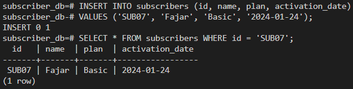

* **Penjelasan Mengapa Kueri:**
Perintah `INSERT INTO` digunakan untuk memasukkan satu baris data baru ke dalam tabel master `subscribers`. Dengan mendefinisikan kolom secara eksplisit (`id`, `name`, `plan`, `activation_date`) dan mencocokkannya dengan nilai yang diminta (`'SUB07'`, `'Fajar'`, `'Basic'`, `'2024-01-24'`), baris data Fajar berhasil direkam secara akurat ke dalam basis data.
* **Hasil:** `1 baris disisipkan (id SUB07)`.

### Q3.2: Ubah Plan Fajar Menjadi Premium

Memperbarui paket langganan Fajar menggunakan kunci primer (`id`), bukan nama (karena nama tidak dijamin unik).

```sql
UPDATE subscribers
SET    plan = 'Premium'
WHERE  id = 'SUB07';

```
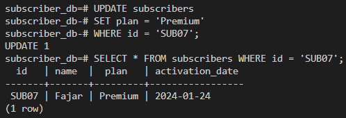

* **Penjelasan Mengapa Kueri:**
Perintah `UPDATE` digunakan untuk memodifikasi data yang sudah ada. Penggunaan klausa `WHERE id = 'SUB07'` memastikan bahwa perubahan hanya diterapkan secara spesifik pada baris milik Fajar berdasarkan kunci primer (`id`), menghindari risiko kesalahan ubah data jika ada nama pelanggan yang sama di masa mendatang.
* **Hasil:** `1 baris diperbarui`.

### Q3.3: Total Penggunaan Data Seluruh Subscriber Premium

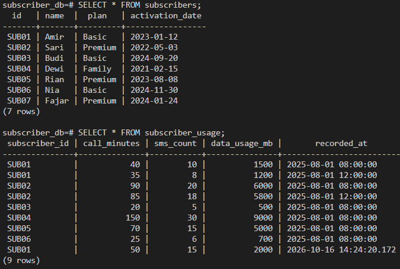

Menghitung total keseluruhan penggunaan data internet (`data_usage_mb`) khusus untuk pelanggan berpaket `Premium`.

```sql
SELECT COALESCE(SUM(u.data_usage_mb), 0) AS total_premium_data_mb
FROM   subscriber_usage u
JOIN   subscribers s ON s.id = u.subscriber_id
WHERE  s.plan = 'Premium';

```
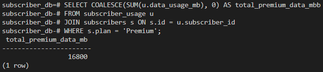

* **Penjelasan Mengapa Kueri:**
Kueri ini menggabungkan tabel `subscriber_usage` dan `subscribers` menggunakan `JOIN` untuk mencocokkan identitas pelanggan. Klausa `WHERE s.plan = 'Premium'` menyaring baris agar hanya mencakup pelanggan paket Premium. Fungsi agregasi `SUM()` menjumlahkan seluruh kolom `data_usage_mb` dari snapshot yang cocok, sementara `COALESCE(..., 0)` bertindak sebagai pengaman agar kueri tetap mengembalikan angka `0` (bukan nilai kosong/NULL) jika tidak ditemukan data.
* **Hasil:** `16.800 MB` (Sari 11.800 MB + Rian 5.000 MB; Fajar belum memiliki catatan penggunaan data).

### Q3.4: Top 3 Subscriber Berdasarkan Total Penggunaan Data

Menampilkan 3 pelanggan dengan total penggunaan data tertinggi, dilengkapi *tie-breaker* berdasarkan `id` agar urutan selalu deterministik.

```sql
SELECT s.id,
       s.name,
       SUM(u.data_usage_mb) AS total_data_mb
FROM   subscriber_usage u
JOIN   subscribers s ON s.id = u.subscriber_id
GROUP  BY s.id, s.name
ORDER  BY total_data_mb DESC, s.id ASC
LIMIT  3;

```

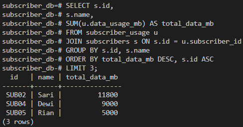

* **Penjelasan Mengapa Kueri:**
Data penggunaan dikelompokkan per pelanggan menggunakan `GROUP BY` dan total penggunaan datanya dihitung lewat fungsi `SUM()`. Pengurutan dilakukan secara menurun (`DESC`) pada kolom total data agar nilai yang terbesar berada di posisi teratas, disertai *tie-breaker* (`s.id ASC`) untuk memastikan konsistensi urutan jika ada nilai yang sama. Terakhir, `LIMIT 3` membatasi keluaran hanya menampilkan 3 baris teratas.
* **Hasil:**
1. `SUB02` - Sari (`11.800 MB`)
2. `SUB04` - Dewi (`9.000 MB`)
3. `SUB05` - Rian (`5.000 MB`)

### Q3.5: Subquery - Subscriber dengan Rata-rata Durasi Panggilan <= 30 Menit

Mencari daftar pelanggan yang memiliki rata-rata durasi panggilan (*call minutes*) per snapshot kurang dari atau sama dengan 30 menit menggunakan pendekatan *subquery*.

```sql
SELECT s.id, 
       s.name, 
       s.plan, 
       ROUND(AVG(u.call_minutes), 2) AS avg_call_minutes
FROM   subscribers s
JOIN   subscriber_usage u ON s.id = u.subscriber_id
GROUP  BY s.id, s.name, s.plan
HAVING AVG(u.call_minutes) <= 30
ORDER  BY s.id;

```

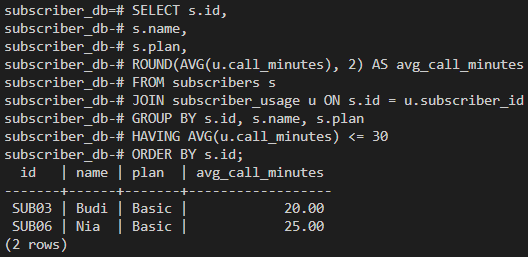

* **Penjelasan Mengapa Kueri:**
Kueri ini menghubungkan tabel master pelanggan dengan tabel penggunaan, lalu mengelompokkan datanya per pelanggan (`GROUP BY`). Fungsi `AVG(u.call_minutes)` menghitung rata-rata durasi panggilan yang dibulatkan rapi dengan `ROUND()`. Klausa `HAVING` digunakan untuk menyaring kelompok hasil agregasi agar hanya menampilkan pelanggan yang nilai rata-ratanya kurang dari atau sama dengan 30 menit ($\le 30$).
* **Hasil:**
* `SUB03` - Budi (Rata-rata 20 menit)
* `SUB06` - Nia (Rata-rata 25 menit)
*(Catatan: Pelanggan tanpa catatan penggunaan seperti Fajar tidak muncul karena tidak memiliki nilai rata-rata).*


# Dokumentasi Teknis Lengkap: Q4 - Troubleshooting & Kode Perbaikan Fungsi `getTotalUsageMB`

## 1. Analisis Akar Masalah (*Root Cause Analysis*)

Fungsi `getTotalUsageMB(records)` pada soal ini adalah fungsi utilitas backend yang bertugas untuk **menghitung total keseluruhan penggunaan data internet (dalam satuan Megabita / MB)** dengan cara menjumlahkan properti `dataUsageMB` dari sekumpulan daftar rekaman penggunaan (*array of records*) milik pelanggan.

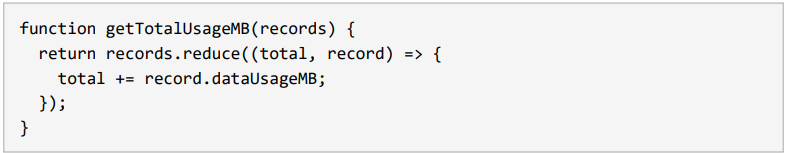

Fungsi JavaScript `Array.prototype.reduce()` mengalami kegagalan total karena dua kesalahan utama yang saling memperparah:

1. **Tidak Ada Nilai Pengembalian (`return`):** Fungsi *callback* di dalam `reduce` wajib mengembalikan nilai akumulasi untuk iterasi berikutnya. Tanpa kata kunci `return`, fungsi secara otomatis menghasilkan `undefined`, dan operasi `total += record.dataUsageMB` hanya mengubah variabel lokal tanpa menyimpannya.
2. **Tidak Ada Nilai Awal (*Initial Value*):** Tanpa memberikan nilai awal (seperti `0`) sebagai argumen kedua pada `reduce()`, nilai `total` pada iterasi pertama akan langsung diisi oleh elemen pertama dari *array* (yang berupa objek), bukan angka (`0`).

**Perilaku Nyata Berdasarkan Kasus (Tanpa Perbaikan):**

* **Array 3 record:** Menghasilkan `undefined` (karena iterasi berikutnya mengolah nilai kosong).
* **Array 1 record:** Mengembalikan objek *record* itu sendiri secara utuh (karena fungsi *callback* dilewati dan langsung mengembalikan elemen pertama).
* **Array kosong:** Memunculkan *runtime error* (`TypeError: Reduce of empty array with no initial value`).

---

## 2. Kode Perbaikan (*Fixed Code*)

Berikut adalah implementasi fungsi yang sudah diperbaiki agar aman, kuat (*robust*), dan tahan terhadap data kotor:

```javascript
function getTotalUsageMB(records) {
  if (!Array.isArray(records)) throw new TypeError('records must be an array');
  return records.reduce((total, record) => {
    const mb = Number(record?.dataUsageMB);
    if (!Number.isFinite(mb)) {
      throw new TypeError(`Invalid dataUsageMB: ${JSON.stringify(record?.dataUsageMB)}`);
    }
    return total + mb;
  }, 0);
}

```

**Inti Perbaikan:**

* Menambahkan nilai awal **`0`** di akhir fungsi `reduce(..., 0)` agar perhitungan dimulai dari angka nol.
* Menambahkan kata kunci **`return total + mb`** agar hasil penjumlahan diteruskan ke iterasi berikutnya.
* Menambahkan validasi tipe data (`Number.isFinite`) guna mencegah hasil `NaN` diam-diam apabila data masukan korup.

---

## 3. Strategi Pencegahan di Masa Depan (*Future Prevention*)

Untuk mencegah bug serupa terulang kembali dalam siklus pengembangan perangkat lunak, langkah-langkah mitigasi berikut diterapkan:

1. **Penerapan Linter Otomatis (ESLint):** Mengaktifkan aturan `array-callback-return` untuk mendeteksi fungsi `reduce` tanpa nilai kembalian, dan `no-param-reassign` untuk mencegah mutasi parameter. Aturan ini dijalankan dalam jalur *CI (Continuous Integration)*.
2. **Pengujian Unit (*Unit Testing*):** Membuat cakupan pengujian menyeluruh (`tests/q4.test.js`) yang menguji berbagai kasus tepi (*edge cases*), seperti *array* kosong, *array* dengan satu elemen, hingga masukan data kotor.
3. **Penerapan Sistem Tipe Statis:** Memanfaatkan **TypeScript** untuk memastikan kompiler menolak struktur data yang tidak sesuai tipe serta mendeteksi fungsi yang seharusnya mengembalikan angka tetapi justru mengembalikan `void` (tanpa *return*).
4. **Standar *Code Review*:** Menjadikan aturan *"callback pada fungsi iterasi array wajib mengembalikan nilai"* sebagai salah satu poin wajib dalam daftar periksa (*checklist*) peninjauan kode tim.

---
